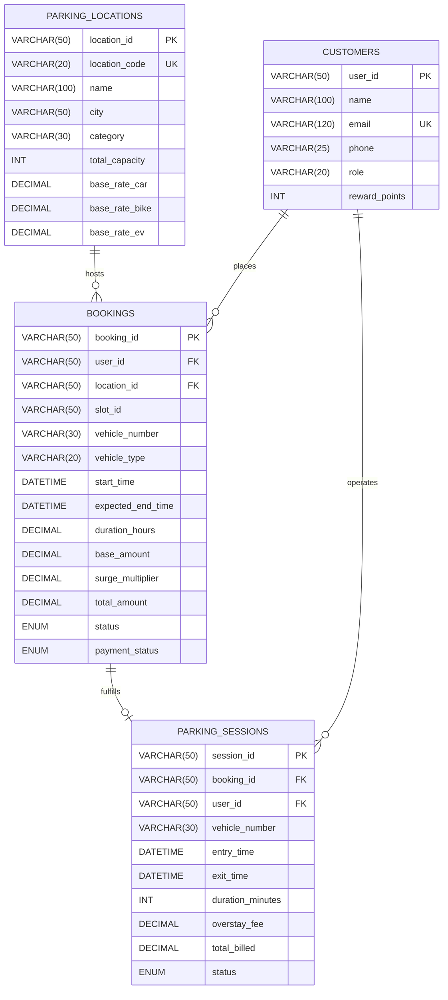

# ParkPulse Analytics — MySQL Relational Data Dictionary
**Platform:** ParkPulse Analytics — Smart Parking Business Intelligence Platform  
**Target RDBMS:** MySQL 8.0+ / MariaDB 10.5+  
**Schema File:** [`analytics/sql/create_tables.sql`](file:///Volumes/Mac%20A/SmartParking/analytics/sql/create_tables.sql)  
**Database Name:** `parkpulse_analytics`

---

## 1. Relational Entity Relationship Architecture

---

## 2. Table Specifications

### 2.1 Table: `parking_locations`
Master registry of smart parking multi-facility physical properties.

| Column Name | Data Type | Nullable | Default | Constraints | Description & Business Rules |
| :--- | :--- | :--- | :--- | :--- | :--- |
| `location_id` | `VARCHAR(50)` | NO | None | **PRIMARY KEY** | Unique facility identifier (e.g. `LOC-101`). |
| `location_code` | `VARCHAR(20)` | NO | None | **UNIQUE** | Short code mnemonic (`CAMPUS`, `MALL`, `TECHPARK`). |
| `name` | `VARCHAR(100)` | NO | None | None | Full display name of the facility. |
| `address` | `VARCHAR(255)` | NO | None | None | Physical civic address. |
| `city` | `VARCHAR(50)` | NO | `'New Delhi'` | None | City name for metropolitan geographic slicing. |
| `category` | `ENUM` | NO | `'campus'` | Check ENUM | Facility type (`campus`, `mall`, `techpark`, `metro`, `hospital`). |
| `total_floors` | `INT` | NO | `1` | `>= 1` | Total multi-level parking decks. |
| `total_capacity` | `INT` | NO | `0` | `>= 0` | Total physical parking bays across all decks. |
| `base_rate_car` | `DECIMAL(10,2)`| NO | `40.00` | In INR (₹) | Standard hourly tariff for four-wheelers. |
| `base_rate_bike`| `DECIMAL(10,2)`| NO | `20.00` | In INR (₹) | Standard hourly tariff for motorcycles / scooters. |
| `base_rate_ev` | `DECIMAL(10,2)`| NO | `50.00` | In INR (₹) | Hourly tariff including Level-2 charging privilege. |
| `is_active` | `BOOLEAN` | NO | `TRUE` | None | Flag indicating facility availability. |
| `created_at` | `TIMESTAMP` | NO | `CURRENT_TIMESTAMP` | None | Initial database registration timestamp. |

---

### 2.2 Table: `customers`
Master user directory for registered smart parking platform members.

| Column Name | Data Type | Nullable | Default | Constraints | Description & Business Rules |
| :--- | :--- | :--- | :--- | :--- | :--- |
| `user_id` | `VARCHAR(50)` | NO | None | **PRIMARY KEY** | Unique customer identifier (e.g. `USR-1001`). |
| `name` | `VARCHAR(100)` | NO | None | None | Full legal customer name. |
| `email` | `VARCHAR(120)` | NO | None | **UNIQUE** | Primary authenticated contact email. |
| `phone` | `VARCHAR(25)` | NO | None | None | Contact mobile number with country prefix. |
| `role` | `ENUM` | NO | `'USER'` | Check ENUM | Platform role: `'USER'`, `'ADMIN'`, `'GATEKEEPER'`. |
| `reward_points`| `INT` | NO | `0` | `>= 0` | Loyalty rewards balance (100 pts = ₹5 discount). |
| `created_at` | `TIMESTAMP` | NO | `CURRENT_TIMESTAMP` | None | Account creation timestamp. |

---

### 2.3 Table: `bookings`
Core transactional ledger capturing smart parking reservations.

| Column Name | Data Type | Nullable | Default | Constraints | Description & Business Rules |
| :--- | :--- | :--- | :--- | :--- | :--- |
| `booking_id` | `VARCHAR(50)` | NO | None | **PRIMARY KEY** | Unique reservation reference (e.g. `BK-2026-0001`). |
| `user_id` | `VARCHAR(50)` | NO | None | **FOREIGN KEY** | References `customers(user_id)`. |
| `location_id` | `VARCHAR(50)` | NO | None | **FOREIGN KEY** | References `parking_locations(location_id)`. |
| `slot_id` | `VARCHAR(50)` | NO | None | None | Assigned bay identifier (e.g. `SLOT-A-101`). |
| `vehicle_number`| `VARCHAR(30)` | NO | None | None | Alphanumeric license plate number. |
| `vehicle_type` | `ENUM` | NO | `'car'` | Check ENUM | Category (`car`, `bike`, `ev`, `truck`). |
| `start_time` | `DATETIME` | NO | None | None | Scheduled parking reservation start time. |
| `expected_end_time`| `DATETIME` | NO | None | None | Scheduled reservation expiry time. |
| `duration_hours`| `DECIMAL(6,2)`| NO | `1.00` | `> 0` | Scheduled booking duration in hours. |
| `base_amount` | `DECIMAL(10,2)`| NO | `0.00` | In INR (₹) | `duration_hours * location_hourly_rate`. |
| `surge_multiplier`| `DECIMAL(4,2)`| NO | `1.00` | `>= 1.00` | Dynamic pricing surge multiplier (e.g. 1.25x). |
| `surge_amount` | `DECIMAL(10,2)`| NO | `0.00` | In INR (₹) | Incremental fee added by peak pricing. |
| `convenience_fee`| `DECIMAL(10,2)`| NO | `10.00` | In INR (₹) | Platform digital processing fee. |
| `total_amount` | `DECIMAL(10,2)`| NO | `0.00` | In INR (₹) | Final gross fee billed to customer. |
| `status` | `ENUM` | NO | `'CONFIRMED'`| Check ENUM | Lifecycle state (`PENDING`, `CONFIRMED`, `ACTIVE`, `COMPLETED`, `CANCELLED`, `EXPIRED`, `NO_SHOW`, `OVERSTAYED`). |
| `payment_status`| `ENUM` | NO | `'paid'` | Check ENUM | Gateway state: `'pending'`, `'paid'`, `'refunded'`, `'failed'`. |
| `check_in_time`| `DATETIME` | YES | `NULL` | None | Physical barrier optical scan ingress time. |
| `check_out_time`| `DATETIME` | YES | `NULL` | None | Physical barrier optical scan egress time. |
| `created_at` | `TIMESTAMP` | NO | `CURRENT_TIMESTAMP` | None | Transaction creation timestamp. |

---

### 2.4 Table: `parking_sessions`
Real-time physical barrier telemetry sessions recorded at gate terminals.

| Column Name | Data Type | Nullable | Default | Constraints | Description & Business Rules |
| :--- | :--- | :--- | :--- | :--- | :--- |
| `session_id` | `VARCHAR(50)` | NO | None | **PRIMARY KEY** | Unique gate hardware session ID. |
| `booking_id` | `VARCHAR(50)` | YES | `NULL` | **FOREIGN KEY** | References `bookings(booking_id)` (Null for walk-in drive-ins). |
| `slot_id` | `VARCHAR(50)` | NO | None | None | Bay hardware ultrasonic detector ID. |
| `user_id` | `VARCHAR(50)` | YES | `NULL` | **FOREIGN KEY** | References `customers(user_id)`. |
| `vehicle_number`| `VARCHAR(30)` | NO | None | None | ANPR captured registration string. |
| `entry_time` | `DATETIME` | NO | None | None | Ultrasonic vehicle arrival timestamp. |
| `exit_time` | `DATETIME` | YES | `NULL` | None | Ultrasonic vehicle departure timestamp. |
| `expected_exit_time`| `DATETIME`| NO | None | None | Permitted grace window expiry. |
| `duration_minutes`| `INT` | NO | `0` | `>= 0` | Actual real-world session dwell time in minutes. |
| `overstay_duration_minutes`| `INT`| NO | `0` | `>= 0` | Dwell past expected checkout threshold. |
| `overstay_fee` | `DECIMAL(10,2)`| NO | `0.00` | In INR (₹) | Penalty charged for unreserved bay hogging. |
| `total_billed` | `DECIMAL(10,2)`| NO | `0.00` | In INR (₹) | Final settled amount collected upon barrier opening. |
| `status` | `ENUM` | NO | `'ACTIVE'` | Check ENUM | Session state: `'ACTIVE'`, `'COMPLETED'`, `'OVERSTAYED'`, `'CANCELLED'`. |
| `created_at` | `TIMESTAMP` | NO | `CURRENT_TIMESTAMP` | None | Session logging timestamp. |
